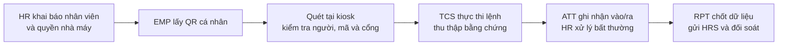
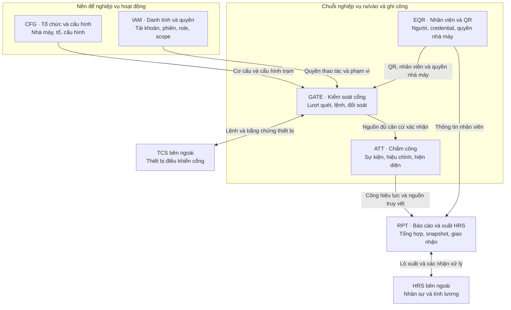
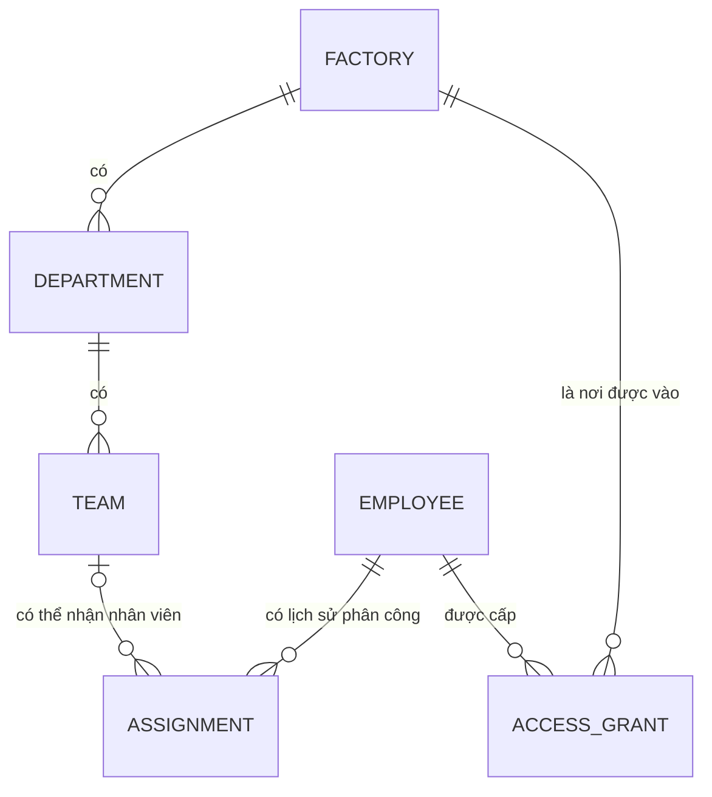
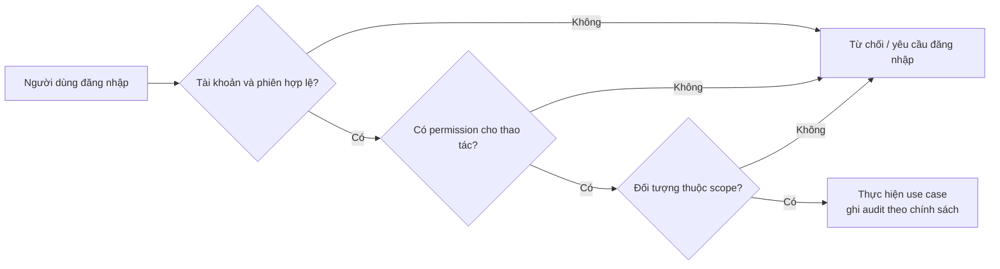
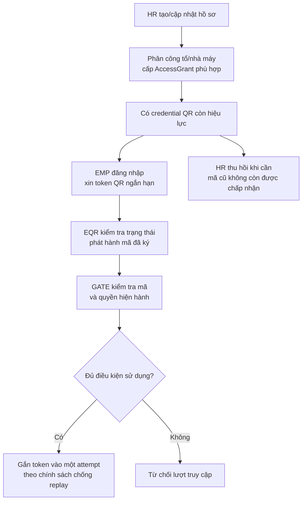
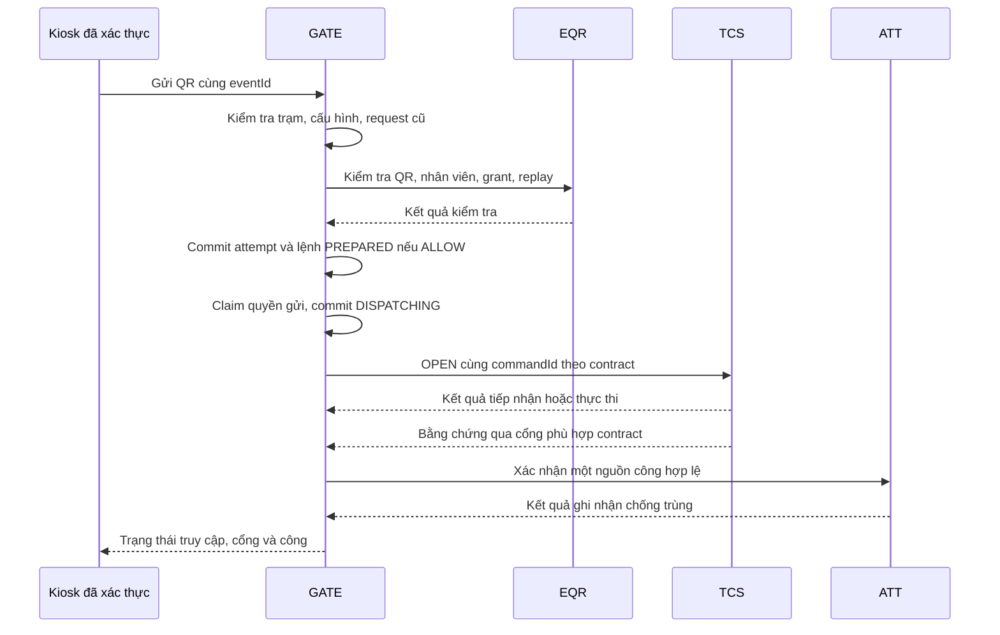
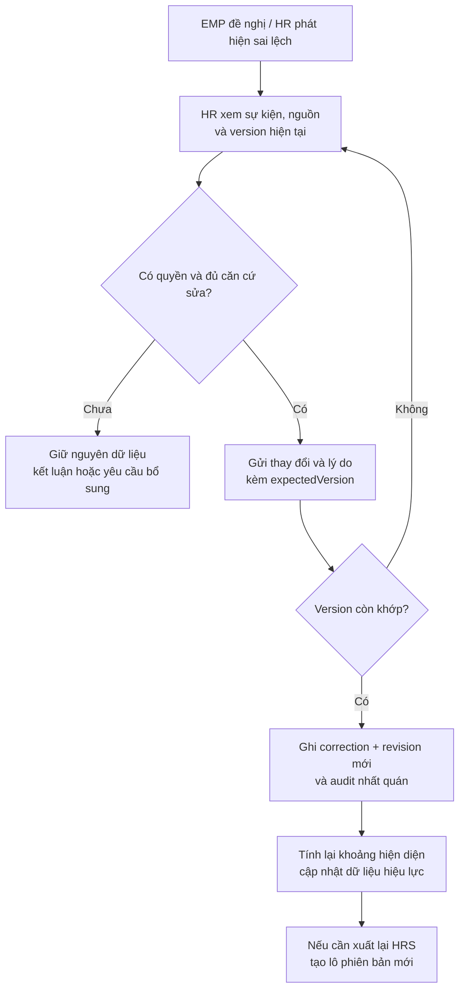
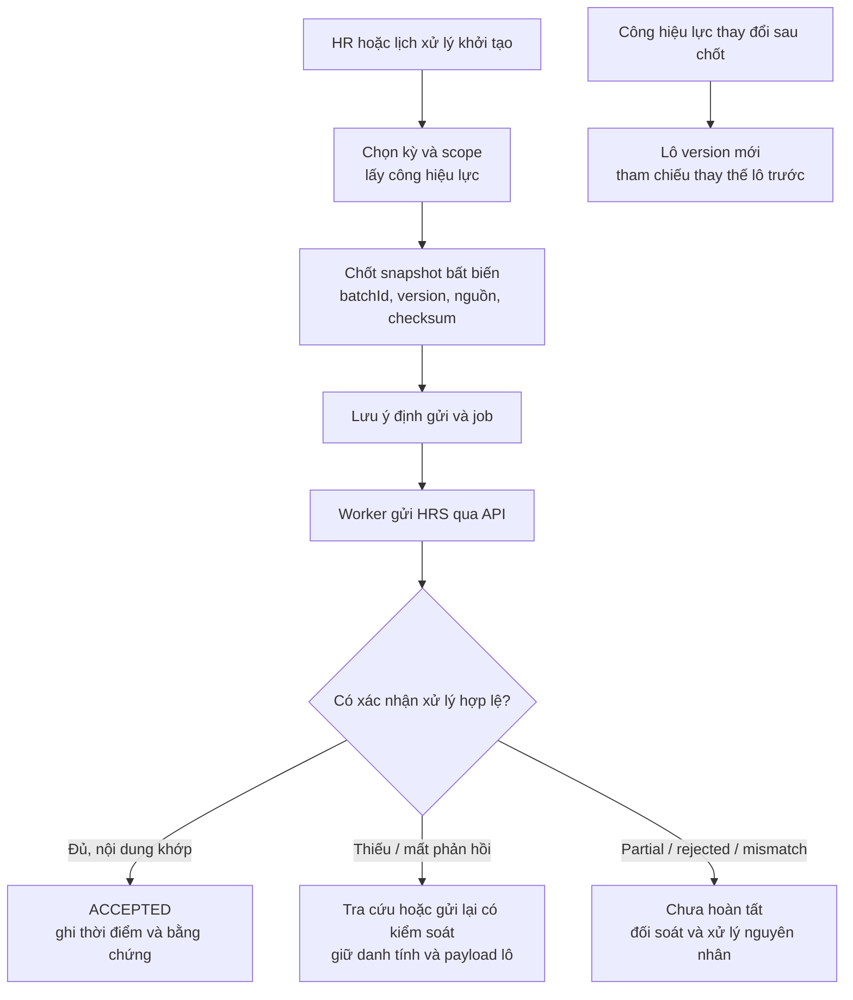
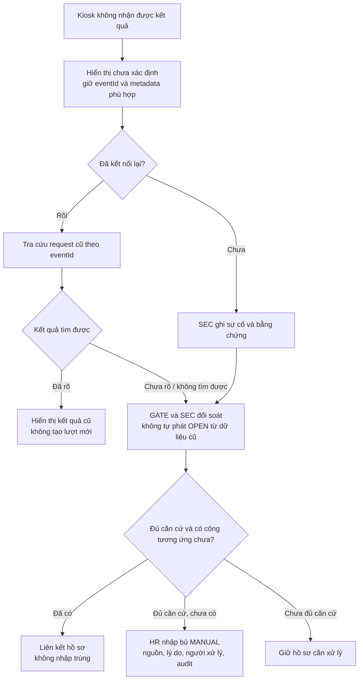

# Domain Know-how — Bản đồ nghiệp vụ TMC Access

**Mục đích:** giúp người mới hiểu app giải quyết việc gì, mỗi miền nghiệp vụ chịu trách nhiệm gì, dữ liệu đi qua các miền ra sao và quy tắc nào phải giữ khi phát triển.

**Căn cứ:** tổng hợp từ [phân tích yêu cầu](sumary-assigment.md), [giải thích nghiệp vụ](explain-detail.md), [user flow](user-flow.md), [schema](schema-database.md), [kiến trúc](structure-architecture.md) và source prototype. Các ví dụ E001, giờ quét và mã lô bên dưới là minh họa.

**Cách hiểu trạng thái:** **Thiết kế đích** là nghiệp vụ được mô tả trong bộ tài liệu M1/M2; **Prototype** là hành vi đọc được từ source frontend dùng localStorage. Các sơ đồ chính diễn giải thiết kế đích; chúng không xác nhận backend, thiết bị thật hoặc HRS đã được tích hợp. Việc đối chiếu source trong tài liệu này là đọc mã, chưa chạy kiểm thử ứng dụng.

**Hiện trạng source được đối chiếu:** prototype đầy đủ màn hình nằm trong `src/` ở root. Workspace cũng có skeleton `client/` và `api/`: client đang hiển thị [KioskPage khởi tạo](../client/src/features/gate/presentation/pages/KioskPage.tsx), backend đã có [ranh giới module](../api/src/modules/README.md), [port cổng](../api/src/modules/gate/application/ports/turnstile.gateway.ts) và các module Nest khởi tạo. Skeleton này là bước chuẩn bị cho cấu trúc đích; các mô tả hành vi demo bên dưới được đối chiếu với `src/`, không mặc định đã chuyển đầy đủ sang `client/` và `api/`.

| Muốn hiểu | Đọc phần |
| --- | --- |
| Toàn cảnh và các miền phối hợp | [1. Bài toán](#bai-toan), [2. Bản đồ miền](#ban-do-mien) |
| Ai được làm gì | [3. Vai trò](#vai-tro), [5. IAM](#iam) |
| Nhân viên, nhà máy và QR | [4. CFG](#cfg), [6. EQR](#eqr) |
| Quét cổng, ghi công và sửa công | [7. GATE](#gate), [8. ATT](#att) |
| Ca làm, báo cáo và dữ liệu cuối tháng | [9. Ca làm](#ca-lam), [10. RPT](#rpt) |
| Thông báo, audit và sự cố | [11. Hỗ trợ vận hành](#van-hanh), [12. Phục hồi](#phuc-hoi) |
| Ví dụ trọn ngày và màn hình hiện tại | [13. Một ngày của E001](#vi-du), [14. Màn hình](#man-hinh) |
| Quy tắc quan trọng và chỗ còn cần chốt | [15. Quy tắc](#quy-tac), [16. Cần chốt](#can-chot) |

## 1. Bài toán nghiệp vụ trong một hình

TMC có hai nhà máy: Bình Dương khoảng 800 nhân viên và Long An khoảng 600 nhân viên. App quản lý việc **đúng người, đúng quyền, đúng điểm cổng**, ghi nhận các lượt vào/ra có căn cứ, rồi cung cấp dữ liệu công để đối soát với hệ thống nhân sự/lương có sẵn.

**TCS** là hệ thống điều khiển cổng xoay. **HRS** là phần mềm HR/Payroll bên ngoài. App TMC sử dụng API của hai hệ thống này theo thiết kế tích hợp.

Trong phạm vi: nhân viên/QR, người dùng/quyền, cổng, chấm công, báo cáo, audit, cấu hình và tích hợp. Quản lý khách, tính lương, chế tạo cổng và logic thoát hiểm thuộc ngoài phạm vi hệ thống đã phân tích. Ca làm và thông báo có trong prototype, cần phân biệt với yêu cầu gốc và phạm vi code M2.

Nguồn nghiệp vụ: [phân tích yêu cầu, phần 2–3](sumary-assigment.md).

## 2. Bản đồ các miền: mỗi miền quyết định một loại việc

Một **miền nghiệp vụ** là nhóm kiến thức, dữ liệu và quy tắc cùng giải quyết một vấn đề. Trong thiết kế hiện tại, sáu module IAM, EQR, GATE, ATT, RPT, CFG là cách tổ chức trách nhiệm đó. Một màn hình có thể dùng nhiều miền; một miền cũng có thể phục vụ nhiều màn hình.

Mũi tên biểu diễn trao đổi nghiệp vụ, không quy định import source hoặc số server. IAM và CFG còn phục vụ các miền khác; sơ đồ chỉ vẽ những quan hệ chính để dễ đọc. Ca làm hỗ trợ diễn giải giờ công; audit, thông báo, jobs và phục hồi hỗ trợ xuyên suốt các miền.

| Miền | Câu hỏi chịu trách nhiệm trả lời | Đối tượng chính | Ranh giới trách nhiệm |
| --- | --- | --- | --- |
| CFG | Đây là nhà máy/tổ nào, cấu hình nào đang áp dụng? | Factory, Department, Team, ConfigVersion, IntegrationEndpoint | Cấu hình không tự cấp quyền quản trị hay xác nhận công. |
| IAM | Ai đang dùng phần mềm, được làm gì trên dữ liệu nào? | User, Role, Permission, RoleAssignment, UserSession, AuditEntry | Quyền dùng portal khác quyền đi qua cổng. |
| EQR | Đây là nhân viên nào, QR và quyền nhà máy còn hiệu lực không? | Employee, EmployeeAssignment, AccessGrant, QrCredential, QrToken, QrRedemption, QrSigningKey | QR hợp lệ chưa chứng minh người đã qua cổng. |
| GATE | Lượt truy cập có được phép và thiết bị đã thực hiện gì? | GateStation, StationCredential, AccessAttempt, GateCommand, GateCommandHistory, GateDeviceEvent, ReconciliationCase | Lượt quét và lệnh mở chưa tự trở thành công chính thức. |
| ATT | Những sự kiện hiện diện nào đủ căn cứ, dữ liệu hiệu lực là gì? | AttendanceEvent, AttendanceEventRevision, AttendanceCorrection, PresenceInterval, AttendanceReviewRequest | Hiện diện/công không phải số tiền lương. |
| RPT | Tổng hợp gì, đã gửi lô nào và HRS đã xử lý chưa? | ExportBatch, ExportItem, ExportItemSource, ExportAttempt | CSV nội bộ khác giao nhận API được HRS xác nhận. |

Danh mục đối tượng theo [schema, phần 2](schema-database.md); trách nhiệm module theo [kiến trúc, phần 2.1](structure-architecture.md) và [giải thích nghiệp vụ, phần 4](explain-detail.md).

## 3. Ai tham gia và phạm vi của từng người

Bảng này theo vai trò **thiết kế đích**. Một người có thể được cấp nhiều vai trò; quyền còn phụ thuộc nhà máy/tổ/đối tượng được giao.

| Vai trò | Việc thường làm | Phạm vi cần giữ | Ví dụ |
| --- | --- | --- | --- |
| EMP — nhân viên | Lấy QR, xem công cá nhân, đề nghị kiểm tra sai lệch | Dữ liệu của chính mình | E001 xem giờ vào hôm qua; gửi yêu cầu nếu thiếu lượt ra. |
| HR — nhân sự | Hồ sơ/QR/quyền nhà máy, kiểm tra và hiệu chỉnh công, xuất HRS | Theo quyền và phạm vi được cấp | Đối chiếu bằng chứng rồi sửa một lượt công có lý do. |
| SUP — giám sát sản xuất | Theo dõi tình hình nhân sự/công của tổ | Tổ được giao | Xem bất thường của tổ A, không tự sửa sổ công. |
| SEC — bảo vệ/an ninh | Theo dõi cổng, hỗ trợ nhân viên, đối soát kết quả chưa rõ | Nhà máy được giao | Xác minh cổng đã mở hay chưa khi thiết bị mất phản hồi. |
| ADM — quản trị | Tài khoản/vai trò, trạm/cấu hình, kết nối và vận hành | Quyền quản trị được cấp cụ thể | Đăng ký kiosk, thu hồi quyền hoặc thay cấu hình đầu kết nối. |
| EXE — ban điều hành | Xem báo cáo tổng hợp | Mức dữ liệu tổng hợp được phép | So sánh tình hình hiện diện hai nhà máy. |

Ví dụ: SEC tại Bình Dương và SEC tại Long An cùng role nhưng có scope khác nhau. ADM quản trị tài khoản không mặc nhiên có quyền HR sửa công. Tài khoản portal của bảo vệ và danh tính thiết bị kiosk cũng là hai chủ thể khác nhau.

Prototype đang dùng sáu role: `SYSTEM_ADMIN`, `HR_MANAGER`, `SECURITY_MANAGER`, `GATE_OPERATOR`, `DEPARTMENT_MANAGER`, `EMPLOYEE`. Hai role an ninh là cách chia trong UI demo; EXE chưa có role tương ứng. `canManage()` hiện cho admin quyền rộng và cho manager xử lý công, khác với giới hạn SUP/ADM trong thiết kế. Cần ánh xạ và chốt quyền khi triển khai backend, thay vì xem hai mô hình đã trùng nhau.

Nguồn: [actors và giới hạn](user-flow.md), [role/scope trong prototype](../src/lib/rbac.ts).

## 4. CFG — Tổ chức nhà máy và cấu hình nghiệp vụ

**Mục tiêu:** các miền khác biết đối tượng thuộc tổ chức nào và cần dùng phiên bản cấu hình nào.

Sơ đồ quan hệ nghiệp vụ được rút gọn; `ASSIGNMENT` ở đây tương ứng EmployeeAssignment do EQR quản lý. Một phân công có nhà máy nhưng có thể chưa gán tổ; ký hiệu `|o` biểu diễn quan hệ tùy chọn đó. CFG sở hữu nhà máy/bộ phận/tổ; EQR sở hữu việc nhân viên được phân công và được vào nhà máy nào. Các FK chi tiết nằm trong schema.

| Khái niệm | Ý nghĩa | Quy tắc dễ nhầm |
| --- | --- | --- |
| Nhà máy | Địa điểm vận hành: Bình Dương, Long An | Nơi làm việc được phân công và nơi được phép đi vào là hai thông tin riêng. |
| Bộ phận/tổ | Cơ cấu tổ chức để quản lý và giới hạn dữ liệu | Chuyển tổ hôm nay không được làm thay đổi lịch sử phân công trước đó. |
| Cấu hình trạm | Làn IN/OUT, nhà máy, thiết bị/đầu kết nối áp dụng | Chiều quét lấy từ cấu hình làn phía server trong thiết kế đích. |
| ConfigVersion | Phiên bản cấu hình dùng ở một thời điểm | Lệnh cũ cần truy được cấu hình lúc xử lý, dù cấu hình hiện tại đã đổi. |
| IntegrationEndpoint | Đầu kết nối TCS/HRS cùng tham chiếu cấu hình | Đổi endpoint hôm nay không được âm thầm đổi đích của một lệnh/lô cũ đang đối soát. |

**Ví dụ:** E001 chuyển từ tổ A sang tổ B vào đầu tháng mới. Báo cáo tháng trước cần dùng lịch sử phân công đúng thời điểm, còn quyền vào Long An cần một AccessGrant phù hợp; việc chuyển tổ không tự cấp quyền đó.

CFG cung cấp dữ liệu cấu hình; GATE chịu trách nhiệm trạng thái hoạt động của trạm và xử lý lượt quét. Xem [nhóm CFG](schema-database.md#t-factories) và [lịch sử phân công](schema-database.md#t-employee_assignments).

## 5. IAM — Danh tính, quyền sử dụng phần mềm và audit

**Mục tiêu:** xác định ai đang thao tác, có quyền gì, được tác động lên đối tượng nào và lưu dấu vết phù hợp.

| Thành phần | Hiểu bằng ví dụ |
| --- | --- |
| User | Tài khoản HR đang đăng nhập portal. |
| Role | HR gom một nhóm quyền nghiệp vụ. |
| Permission | Một quyền cụ thể, ví dụ hiệu chỉnh công hoặc đối soát cổng. |
| Scope | Chỉ áp dụng trên nhà máy/tổ/đối tượng được giao. |
| Session | Phiên đăng nhập có hạn và có thể thu hồi theo thiết kế. |
| AuditEntry | Ai làm gì, lúc nào, trên đối tượng nào, lý do/kết quả và mã truy vết. |

**Quy tắc:** frontend dùng quyền để điều hướng; backend phải kiểm tra quyền và scope trên mỗi thao tác thực tế. Khi đăng xuất hoặc đổi tài khoản, cache dữ liệu cá nhân cần được xử lý theo danh tính mới. Thay đổi nhạy cảm và audit liên quan được thiết kế để ghi nhất quán trong transaction.

**Phân biệt bốn đối tượng:** Employee là người lao động; User là tài khoản phần mềm; AccessGrant là quyền vào nhà máy; RoleAssignment là quyền sử dụng chức năng. Một người có hồ sơ nhân viên không tự có quyền quản trị.

Nguồn: [UF-00 và UF-09](user-flow.md), [nhóm IAM](schema-database.md#t-users).

## 6. EQR — Nhân viên, quyền nhà máy và vòng đời QR

**Mục tiêu:** bảo đảm QR đang dùng thuộc một nhân viên có trạng thái và quyền nhà máy phù hợp.

| Đối tượng | Ý nghĩa | Ví dụ |
| --- | --- | --- |
| Employee | Hồ sơ nhân viên, mã đối soát ổn định | E001. |
| EmployeeAssignment | Lịch sử thuộc nhà máy/bộ phận/tổ | E001 ở tổ A trong tháng 10. |
| AccessGrant | Quyền đi vào một nhà máy trong thời hạn nhất định | E001 được vào Bình Dương, chưa được vào Long An. |
| QrCredential | Định danh QR có vòng đời, có thể thu hồi | Credential của E001 bị thu hồi khi cần cấp lại. |
| QrToken | Một lần phát hành mã ngắn hạn, có định danh `jti` | Mã đang hiển thị trên điện thoại. |
| QrRedemption | Ghi nhận token được gắn với attempt nào | Token X đã được dùng cho attempt A. |
| QrSigningKey | Metadata khóa dùng để xác minh mã đã ký | Xác định khóa nào và trạng thái hiệu lực của khóa. |

Hai quy tắc khác nhau cần cùng tồn tại:

- **Chống replay:** token đã gắn attempt A không được dùng làm attempt B để tạo lượt mới trái chính sách.
- **Idempotency:** kiosk tra cứu/gửi lại đúng request A sau mất phản hồi phải nhận trạng thái của A, không tạo lượt mới hoặc tiêu thụ mã lần nữa. Token hết hạn sau khi request đã được tiếp nhận không làm mất quyền tra cứu kết quả cũ.

QR bị lộ được xử lý bằng thu hồi, mã ngắn hạn, kiểm tra quyền hiện hành và chống replay theo đề xuất M2. Chữ ký bảo vệ tính hợp lệ của mã; QR ngắn hạn vẫn có thể bị chia sẻ ngay cho người khác, nên chưa tự chứng minh người cầm điện thoại là đúng nhân viên.

**Prototype:** QR có hạn 60 giây nhưng không có chữ ký; `qrLocked` là cờ khóa demo. Cooldown 30 giây trong luồng quét là cơ chế demo riêng, chưa thay thế kiểm soát `jti` trên server.

Nguồn: [UF-01/UF-04](user-flow.md), [QR M2 trong tech stack, phần 9.1](teach-stack.md), [mã QR prototype](../src/lib/qr.ts).

## 7. GATE — Kiểm soát truy cập và tác động tới cổng

**Mục tiêu:** xử lý lượt quét có thể truy vết, xác định quyền truy cập, gửi lệnh đúng điều kiện và quản lý kết quả thiết bị.

Đây là luồng thành công minh họa khi có bằng chứng qua cổng phù hợp; phản hồi/polling thực tế có thể tách nhiều bước. Với mock TCS/sensor cần ghi rõ là bằng chứng giả lập. Khi chưa có nguồn xác nhận tự động theo contract, kết quả phải được xử lý theo chính sách và quy trình đối soát đã chọn.

### 7.1. Ba kết quả phải đọc riêng

| Kết quả | Trả lời câu hỏi | Ví dụ trạng thái/diễn giải |
| --- | --- | --- |
| Quyết định truy cập | Có cho phép lượt này không? | ALLOW hoặc DENIED. |
| Kết quả lệnh cổng | Thiết bị đã nhận/thực hiện lệnh ra sao? | PREPARED, DISPATCHING, ACKNOWLEDGED, CONFIRMED, REJECTED, UNKNOWN, EXPIRED, CANCELLED trong schema. |
| Kết quả ghi công | Đã đủ căn cứ và ghi nhận công chưa? | NOT_CREATED, PROVISIONAL, CONFIRMED theo mô hình trạng thái được thiết kế. |

Ví dụ: **ALLOW + ACKNOWLEDGED + NOT_CREATED** có thể nghĩa là người đủ quyền, thiết bị mới báo nhận lệnh, chưa đủ bằng chứng ghi công. **Cổng đã mở + chưa có bằng chứng đi qua** cũng chưa tự xác nhận công. Trong mô tả API/flow, `OPEN_CONFIRMED` diễn giải kết quả của command OPEN; schema lưu state `CONFIRMED` cùng `kind=OPEN`.

### 7.2. Các đối tượng và quy tắc giữ đúng

| Đối tượng/quy tắc | Ý nghĩa nghiệp vụ |
| --- | --- |
| GateStation / StationCredential | Điểm quét có danh tính và cấu hình, không tin cổng/chiều chỉ do client tự khai. |
| AccessAttempt | Hồ sơ xử lý yêu cầu, kể cả lượt bị từ chối; chưa phải một AttendanceEvent. |
| GateCommand | Một lệnh OPEN/CLOSE vật lý, có định danh và lịch sử riêng. |
| GateDeviceEvent | Bằng chứng thiết bị được kiểm tra nguồn và chống nhận trùng theo contract. |
| ReconciliationCase | Hồ sơ làm rõ kết quả chưa biết, có người xử lý, lý do và bằng chứng. |
| Lưu trước khi mở | Ghi bền vững ý định xử lý trước tác động thiết bị để còn dấu vết phục hồi. |
| Một quyền gửi OPEN cơ sở | Request trùng/concurrent không được tự tạo thêm OPEN; constraint và claim cần được thực thi ở backend/DB. |
| UNKNOWN | Chưa biết kết quả, có thể thiết bị đã tác động; tra cứu/đối soát thay vì tự mở lại. |
| Deadline | Lệnh chưa gửi đã hết hạn không được tự mở muộn khi mạng phục hồi. |

Nguồn: [UF-02/UF-03/UF-05](user-flow.md), [GateCommand và rules](schema-database.md#t-gate_commands).

## 8. ATT — Sổ công, khoảng hiện diện và hiệu chỉnh

**Mục tiêu:** giữ các sự kiện vào/ra có nguồn xác nhận, biểu diễn dữ liệu hiệu lực và tạo thông tin hiện diện đúng từ những sự kiện đó.

| Lớp dữ liệu | Nội dung | Vai trò |
| --- | --- | --- |
| AttendanceEvent | Một nguồn sự kiện công được xác nhận | Giữ danh tính nguồn, chống tạo trùng. |
| AttendanceEventRevision | Nội dung theo từng phiên bản của sự kiện | Revision 1 là dữ liệu ban đầu; bản mới diễn giải hiệu lực sau thay đổi. |
| AttendanceCorrection | Hồ sơ thay đổi có lý do, người xử lý và version | Giải thích vì sao dữ liệu hiệu lực khác dữ liệu gốc. |
| PresenceInterval | Khoảng hiện diện ghép từ IN/OUT hợp lệ | Dữ liệu dẫn xuất có thể tính lại từ sổ sự kiện. |
| AttendanceReviewRequest | Đề nghị EMP nhờ HR kiểm tra | Yêu cầu được xem xét, không tự cấp quyền sửa công. |

### 8.1. Hiểu đúng cách tính hiện diện

Ví dụ minh họa trong cùng một ngày, giờ địa phương:

| Sự kiện | Thời điểm | Khoảng hiện diện tạo được |
| --- | --- | --- |
| IN | 08:00 | Bắt đầu khoảng 1. |
| OUT | 12:00 | Khoảng 1 = 08:00–12:00 = 4 giờ. |
| IN | 13:00 | Bắt đầu khoảng 2. |
| OUT | 17:00 | Khoảng 2 = 13:00–17:00 = 4 giờ. |
| **Tổng** | | **8 giờ hiện diện; khoảng 12:00–13:00 không được cộng.** |

Các lượt IN/IN, OUT thiếu IN, thiếu OUT, qua đêm hoặc qua tháng cần được nhận diện và xử lý theo chính sách. Thiếu một lượt không tự trở thành đủ một ca. Thời điểm sự kiện và thời điểm HR nhập bù là hai thông tin khác nhau. Thiết kế lưu instant và diễn giải lịch nghiệp vụ theo `Asia/Ho_Chi_Minh`.

### 8.2. Hiệu chỉnh công có truy vết

Sự kiện/revision gốc được giữ lại. Hai HR cùng sửa một version cần nhận biết xung đột; người sửa sau tải lại dữ liệu thay vì ghi đè kết quả mới. Nhập bù sau sự cố phải đối chiếu nguồn đã phục hồi để tránh ghi công lần hai.

**Prototype:** `Attendance` lưu `checkIn/checkOut` theo ngày; duyệt Adjustment cập nhật bản ghi đó trực tiếp. Đây là mô hình demo đơn giản hơn ledger/revision của thiết kế đích.

Nguồn: [UF-06](user-flow.md), [nhóm ATT](schema-database.md#t-attendance_events), [API demo](../src/data/api.ts).

## 9. Ca làm — Kỳ vọng về thời gian làm việc

**Mục tiêu:** biết nhân viên dự kiến làm ca nào để diễn giải dữ liệu ngày làm việc và hỗ trợ theo dõi đúng giờ/đi muộn. Đây là phần hiện có trong prototype; mức mở rộng thành nghiệp vụ lập lịch đầy đủ còn cần chốt.

| Thành phần prototype | Công dụng | Giới hạn cần hiểu |
| --- | --- | --- |
| Shift: tên, bắt đầu, kết thúc, grace | Mẫu ca và số phút linh hoạt sau giờ bắt đầu | Chưa phải toàn bộ quy tắc hợp đồng lao động hoặc tính lương. |
| Employee.shiftId | Gán một ca hiện tại cho nhân viên | Chưa thể hiện lịch phân ca có version theo từng ngày. |
| Phân ca theo nhóm/phòng ban | Cập nhật ca cho nhiều nhân viên được chọn | Muốn bảo toàn lịch sử khi đổi ca cần thiết kế dữ liệu hiệu lực theo thời gian. |
| Trạng thái on-time/late/absent/leave | Nhãn theo dõi trên dữ liệu demo | Có nhãn nghỉ phép không chứng minh đã có workflow xin/duyệt phép. |

Ví dụ minh họa: ca bắt đầu 08:00, grace 5 phút; theo công thức prototype, 08:05 chưa bị đánh dấu muộn, 08:06 bị đánh dấu muộn. Đây là quy tắc demo được đọc từ source, không phải mức grace do đề bài quy định.

Luồng quét demo có xử lý ngày công cho ca qua đêm theo cách đơn giản trong code. Quy tắc nghiệp vụ cho ca đêm, đổi ca, thiếu lượt, làm thêm và phép cần chốt riêng; schema thiết kế hiện tại chưa có nhóm bảng lịch ca đầy đủ. Không suy ra mọi trường hợp này đã được thiết kế hoặc hiện thực chỉ từ màn Ca làm.

Nguồn: [Shift/Employee trong kiểu dữ liệu](../src/data/types.ts), [màn Ca làm](../src/features/shifts/Shifts.tsx), [xử lý công demo](../src/data/api.ts), [điểm chưa chốt của đặc tả](sumary-assigment.md).

## 10. RPT — Báo cáo, chốt dữ liệu và giao nhận HRS

**Mục tiêu:** cung cấp thông tin đúng quyền cho con người và chuyển dữ liệu công có thể đối soát sang HRS.

| Nhánh nghiệp vụ | Người dùng/đích nhận | Kết quả |
| --- | --- | --- |
| Báo cáo nhân sự/công | HR, SUP theo scope | Hiện diện, bất thường và dữ liệu trong phạm vi được phép. |
| Báo cáo cổng/an ninh | SEC theo nhà máy | Lượt truy cập, lý do từ chối và hồ sơ chưa rõ kết quả. |
| Báo cáo điều hành | EXE theo quyền tổng hợp | Thông tin quản lý ở mức được phép. |
| Giao nhận công | HRS qua API | Lô có kỳ/version, snapshot, nguồn và xác nhận xử lý. |

| Đối tượng | Cần nhớ |
| --- | --- |
| ExportBatch | Một lô nghiệp vụ của kỳ/scope/version, có payload được chốt. |
| ExportItem | Dữ liệu từng item theo contract đã chọn. |
| ExportItemSource | Truy được đúng revision công tạo ra item. |
| ExportAttempt | Một lần gửi hoặc tra cứu; nhiều lần gửi vẫn có thể thuộc một lô. |

**Quy tắc trọng tâm:**

- Dữ liệu phải sẵn sàng đối soát tại HRS **trước 12:00 trưa ngày 1 hằng tháng** theo yêu cầu đã được phân tích. Lịch nội bộ cần chừa thời gian phát hiện lỗi và phục hồi.
- HTTP 2xx hoặc ACK tiếp nhận chưa tự chứng minh HRS xử lý xong. Cần kiểm tra loại xác nhận và nội dung tương ứng contract.
- Retry cùng lô giữ định danh và payload đã chốt; dữ liệu công thay đổi cần version/lô mới theo thiết kế, giữ quan hệ thay thế và lịch sử.
- Chỉnh công sau chốt không được viết lại snapshot đã gửi. Kế hoạch xử lý lô hiệu chỉnh cần thỏa thuận HRS và giữ lịch sử đúng/trễ hạn của lô ban đầu.
- HRS xử lý tính lương. TMC xuất dữ liệu hiện diện/công, không tự thêm công thức lương vào miền này.

**Prototype:** có báo cáo và xuất CSV theo bộ lọc; chưa có giao nhận HRS trong lớp API demo đã đọc. CSV phục vụ người dùng không thay bước gửi API/xác nhận lô.

Nguồn: [UF-07/UF-08](user-flow.md), [nhóm RPT](schema-database.md#t-export_batches), [báo cáo prototype](../src/features/reports/Reports.tsx).

## 11. Audit, thông báo và công việc nền

Các chức năng này hỗ trợ nhiều miền. Trong schema, AuditEntry thuộc IAM; OutboxMessage và BackgroundJob thuộc nhóm OPS. OPS là nhóm hạ tầng, không được tự suy ra thành module nghiệp vụ thứ bảy của M1.

| Khái niệm | Việc giải quyết | Ví dụ | Khác biệt cần giữ |
| --- | --- | --- | --- |
| Audit | Giải thích thay đổi nhạy cảm và người thực hiện | HR sửa giờ ra, lý do, version trước/sau, thời điểm và đối tượng | Nhật ký lỗi kỹ thuật đơn thuần chưa phải audit nghiệp vụ đầy đủ. |
| Thông báo nhân viên | Cho EMP biết kết quả/việc cần chú ý | Đề nghị điều chỉnh đã được duyệt | Thông báo không phải dữ liệu gốc xác nhận công. |
| Outbox | Giữ ý định chuyển tiếp gắn với thay đổi nghiệp vụ | Lô đã chốt cần được gửi HRS | Khác WAL của DB và khác số lần thực thi job. |
| BackgroundJob | Quản lý công việc chờ/chạy/thử lại/đối soát | Gửi HRS, dựng lại projection, tra cứu kết quả | Job hết lease không tự cho phép gửi lại một OPEN chưa rõ tác động. |
| Worker | Thành phần đọc và xử lý công việc | Nhận một job gửi HRS | Worker là thành phần nội bộ, không phải vai trò người dùng. |

**Ví dụ:** lô công được chốt và ý định gửi được lưu nhất quán. HRS ngừng hoạt động thì công việc vẫn được theo dõi để xử lý tiếp theo contract; UI không được báo lô đã hoàn tất chỉ vì job đã được tạo.

Prototype có Notification theo nhân viên, cờ đã đọc và tạo thông báo khi duyệt điều chỉnh. Đây là thông báo trong dữ liệu trình duyệt; chưa chứng minh có push/email/SMS. Giao diện sáng/tối và đặt lại dữ liệu demo là tiện ích ứng dụng; chúng không phải nghiệp vụ xác nhận hiện diện hay đối soát lương.

Nguồn: [Outbox/Job/Worker](explain-detail.md), [nhóm OPS](schema-database.md#t-outbox_messages), [API thông báo demo](../src/data/api.ts).

## 12. Khi sự cố xảy ra, miền nào giải quyết?

Thiết kế M2 hiện ưu tiên mức R1: phục hồi và đối soát giao dịch đã tiếp nhận, có xử lý thủ công có nguồn. Mở cổng tự động tại nhà máy khi WAN mất hoàn toàn là phương án mở rộng R2, cần kiến trúc edge và policy riêng.

| Tình huống | Miền phối hợp | Kết quả đúng cần hướng tới |
| --- | --- | --- |
| QR hết hạn/bị thu hồi/sai quyền | EQR + GATE | Từ chối, có lý do, không ghi công thành công hoặc mở cổng từ lượt không hợp lệ. |
| DB lỗi trước khi lưu ý định | GATE + hạ tầng | Chưa gửi OPEN, chưa báo đã ghi nhận thành công. |
| TCS có thể đã mở nhưng mất phản hồi | GATE + SEC | Giữ kết quả chưa rõ và đối soát; không coi timeout là bằng chứng chưa mở. |
| Cùng request hoặc callback đến nhiều lần | GATE + EQR + ATT | Giữ danh tính nguồn, không tự tạo thêm tác động hoặc công. |
| Nhân viên thiếu lượt sau sự cố | ATT + HR + SEC | Kiểm tra dữ liệu phục hồi và bằng chứng trước khi nhập bù. |
| Hai HR sửa cùng dữ liệu | ATT + IAM | Phát hiện version conflict, giữ lịch sử và quyền thao tác. |
| HRS đã nhận nhưng TMC mất ACK | RPT + OPS | Tra cứu/gửi lại theo contract và định danh lô, chưa báo hoàn tất khi chưa đủ bằng chứng. |

Journal ở kiosk hỗ trợ tìm lại request; nó không tự trở thành sổ công chính thức. Một thao tác mở cổng ngoại lệ mới cần có quyền, lý do và dấu vết riêng theo policy, không sửa request UNKNOWN thành PREPARED để mở lại.

Nguồn: [UF-03/UF-05](user-flow.md), [các mức phục hồi, phần 9.2](teach-stack.md).

## 13. Theo dõi một ngày của E001 qua các miền

Ví dụ theo thiết kế đích: E001 thuộc tổ A ở Bình Dương, có quyền vào nhà máy này. Các mốc giờ giả định dưới đây không phải log thật.

| Thời điểm/tình huống | Việc xảy ra | Miền chịu trách nhiệm | Bằng chứng/kết quả |
| --- | --- | --- | --- |
| Trước ngày làm | HR lập hồ sơ, phân công và cấp quyền | EQR dùng cơ cấu CFG; IAM kiểm tra quyền HR | Hồ sơ, lịch sử phân công, AccessGrant, audit. |
| Trước lượt vào | EMP đăng nhập và mở QR | IAM + EQR | Phiên hợp lệ, token hiện hành. |
| 08:00 | Quét làn IN Bình Dương | GATE phối hợp EQR/CFG | Attempt có danh tính, kết quả kiểm tra, lệnh và lịch sử. |
| Sau khi đủ bằng chứng qua cổng | Xác nhận lượt vào | GATE → ATT | Một nguồn công IN, revision ban đầu. |
| 12:00, 13:00, 17:00 | Ra trưa, vào lại, kết thúc ngày | GATE → ATT | Bốn sự kiện tạo hai khoảng hiện diện, tổng 8 giờ. |
| Nếu lượt 17:00 bị thiếu | EMP đề nghị kiểm tra, HR phối hợp SEC | ATT + GATE + IAM | Kết luận hoặc hiệu chỉnh/nhập bù có căn cứ và audit. |
| Cuối kỳ | HR chốt và gửi dữ liệu tháng | RPT + ATT + EQR + OPS | Snapshot, nguồn revision, lô và lịch sử giao nhận. |
| HRS xác nhận xử lý | Đối soát kết quả và thời hạn | RPT ↔ HRS | Xác nhận hợp lệ, thời điểm, trạng thái hoàn tất hoặc lỗi cần xử lý. |

Nếu E001 đổi tổ hoặc bị thu hồi quyền, lượt quét tiếp theo dùng trạng thái hiện hành; dữ liệu lịch sử và snapshot đã chốt vẫn phải giải thích được theo thời điểm của chúng.

## 14. Màn hình prototype liên quan miền nào?

Bảng này đối chiếu route/source prototype trong `src/` ở root, giúp tìm điểm vào khi phát triển. Skeleton `client/` có phạm vi riêng như đã ghi ở đầu tài liệu. Có màn hình không đồng nghĩa đã có backend thực thi các quy tắc của miền.

| Màn hình/route | Miền liên quan | Hành vi đọc được trong prototype | Thiết kế đích cần phân biệt |
| --- | --- | --- | --- |
| `/` | Kênh giới thiệu | Website công khai | Nội dung giới thiệu không là nguồn quyền hoặc nguồn công. |
| `/dang-nhap` | IAM | Chọn/đăng nhập tài khoản demo | Phiên và authorization thực tại backend. |
| `/app/tong-quan` | RPT, ATT, GATE, EQR | KPI/dữ liệu demo | Query đúng phạm vi, nguồn và thời điểm tổng hợp. |
| `/app/nhan-su` | EQR, CFG | Quản lý hồ sơ, trạng thái và khóa QR | Grant, lịch sử phân công, credential/token và audit. |
| `/app/cham-cong` | ATT | Bảng theo ngày, đề nghị/duyệt điều chỉnh | Ledger, revision, chống trùng nguồn và concurrency. |
| `/app/kiem-soat`, `/kiosk` | GATE, EQR, CFG | Lượt quét, camera/mô phỏng, xác nhận thủ công | Danh tính trạm, command state, bằng chứng thiết bị, đối soát. |
| `/app/ca-lam` | Nghiệp vụ ca làm hỗ trợ ATT | Tạo/sửa/gán ca | Lịch theo ngày, lịch sử và quy tắc ca phức tạp cần chốt. |
| `/app/bao-cao` | RPT | Biểu đồ và CSV theo bộ lọc | HRS API, snapshot/version và ACK xử lý. |
| `/app/cai-dat` | CFG và vận hành | Thông tin/cổng/demo reset | Quản trị cấu hình/phiên bản, endpoint và quyền theo thiết kế. |
| `/mobile/trang-chu`, `/mobile/ma-qr` | IAM, EQR, ATT | Không gian nhân viên và QR | Phát hành mã từ server, dữ liệu đúng chủ thể. |
| `/mobile/lich-su`, `/mobile/thong-bao`, `/mobile/tai-khoan` | ATT, EQR, IAM và thông báo | Công cá nhân, thông báo, tài khoản | API có scope, trạng thái và quyền được xác thực. |

Lớp `api` hiện đọc/ghi localStorage; quét demo tự luân phiên ENTRY/EXIT và cập nhật công khi `allowed`. Thiết kế đích lấy chiều từ trạm, tách kết quả cổng/công và chỉ ghi công chính thức theo nguồn đủ bằng chứng. Đây là khác biệt cần xử lý khi chuyển sang backend.

Nguồn: [router](../src/app/router.tsx), [kiểu dữ liệu demo](../src/data/types.ts), [API demo](../src/data/api.ts), [màn hình và flow đích](user-flow.md).

## 15. Những quy tắc cần nhớ khi giao task cho agent

Các dòng dưới là tổng hợp để đọc nhanh, không phải mã requirement mới từ đề gốc.

| Khi giao việc về… | Cần giữ đúng |
| --- | --- |
| Người dùng và nhân viên | User, Employee, RoleAssignment và AccessGrant có trách nhiệm riêng. |
| Quyền | Kiểm tra permission + scope + đối tượng tại backend; thiết kế không mặc định ADM sửa mọi công hoặc SUP tự hiệu chỉnh. |
| QR | Mã hợp lệ, quyền hiện hành và người đã qua cổng là các điều kiện/kết quả khác nhau. |
| Chống trùng | Request, token, command, nguồn công và batch có định danh riêng; tránh dùng lẫn mục đích của chúng. |
| Cổng | Lưu dấu vết trước tác động; không tự phát lại OPEN vì timeout/reload/job hết lease. |
| Công | Đủ bằng chứng mới ghi nhận; retry/callback/nhập bù không được tạo thêm cùng một nguồn. |
| Hiệu chỉnh | Giữ dữ liệu gốc, revision/correction, lý do và audit; phát hiện sửa đồng thời. |
| Hiện diện | Cộng các khoảng phù hợp; không lấy giờ đầu–cuối để cộng cả thời gian vắng. |
| Tổ chức và cấu hình | Đổi hiện tại không làm mất khả năng giải thích quá khứ. |
| Xuất HRS | Snapshot bất biến, retry giữ định danh/payload; dữ liệu thay đổi dùng version mới theo contract. |
| Kết quả giao nhận | Đọc đúng loại ACK; HTTP thành công, cổng mở, công đã ghi và HRS đã xử lý là các kết quả riêng. |
| Phạm vi sản phẩm | Ca/leave/thông báo trong UI demo không tự mở rộng thành payroll, duyệt phép đầy đủ hoặc push notification thực. |
| Trạng thái bàn giao | Ghi đúng phần prototype, thiết kế, đã triển khai và đã kiểm chứng. |

## 16. Những quyết định cần chốt trước khi mở rộng nghiệp vụ

| Chủ đề | Câu hỏi còn ảnh hưởng đến thiết kế/triển khai |
| --- | --- |
| Quyền và role | Ánh xạ role prototype với EMP/HR/SUP/SEC/ADM/EXE; quyền cụ thể và scope của từng thao tác là gì? |
| Bằng chứng qua cổng | TCS/sensor cung cấp sự kiện gì, xác thực/chống trùng ra sao, khi nào đủ căn cứ ghi công? |
| Ngoại lệ và nhập bù | Ai được xác nhận điều gì, cần bằng chứng nào, phân biệt quyền SEC và HR ra sao? |
| QR | Chính sách hết hạn, thu hồi, chuyển đổi QR cũ và xử lý chia sẻ mã được chọn ở mức nào? |
| Mất mạng | Phạm vi R1 đã chọn cần hiện thực những gì; có thực sự cần R2 tự động offline không? |
| Ca và ngày công | Lịch hiệu lực theo ngày, đổi ca, ca đêm, thiếu lượt, phép và làm thêm được xử lý theo rule nào? |
| Chốt kỳ/HRS | Contract payload/ACK, dữ liệu nguồn, ca qua tháng và cách thay thế lô hiệu chỉnh được thống nhất ra sao? |
| Lưu trữ và dữ liệu cá nhân | Người được xem, thông tin hiển thị/log, thời hạn lưu trữ và quy trình lưu/khôi phục nào đã được phê duyệt? |

Những câu hỏi này được ghi nhận để tránh biến giả định thành rule đã chốt. Chi tiết tiếp tục tra ở [user-flow.md](user-flow.md), [schema-database.md](schema-database.md), [teach-stack.md](teach-stack.md) và [work-flow.md](work-flow.md).

## 17. Dùng tài liệu nào cho bước tiếp theo?

| Nhu cầu | Tài liệu chính |
| --- | --- |
| Xác định yêu cầu gốc, scope và mốc bàn giao | [sumary-assigment.md](sumary-assigment.md) và các PDF được tài liệu đó dẫn nguồn. |
| Hiểu một thuật ngữ như ACK, CAS, idempotency hoặc Outbox | [explain-detail.md](explain-detail.md). |
| Xem các bước thao tác, nhánh lỗi và use case theo actor | [user-flow.md](user-flow.md). |
| Chọn stack/pattern và hiểu giải pháp QR/mất mạng | [teach-stack.md](teach-stack.md). |
| Tìm module, chiều import, port và cấu trúc source đích | [structure-architecture.md](structure-architecture.md). |
| Viết model/migration/transaction có ràng buộc dữ liệu | [schema-database.md](schema-database.md). |
| Chọn ticket, dependency, tiêu chí nghiệm thu và phạm vi triển khai | [work-flow.md](work-flow.md). |

Tài liệu này giải thích toàn cảnh nghiệp vụ và mối liên hệ giữa các miền. Khi thay đổi một rule, cần đối chiếu các flow, schema và ticket phụ thuộc để cập nhật chúng nhất quán.
